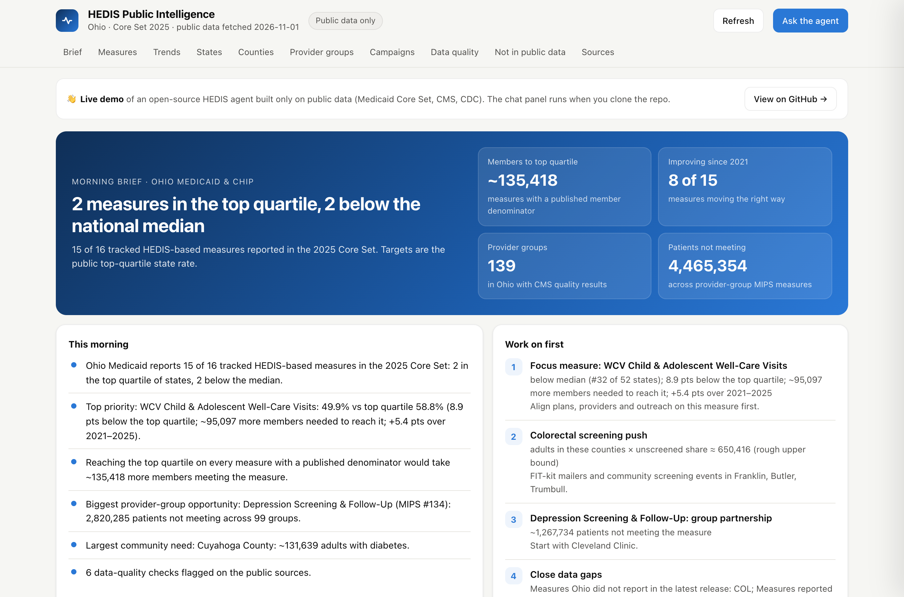
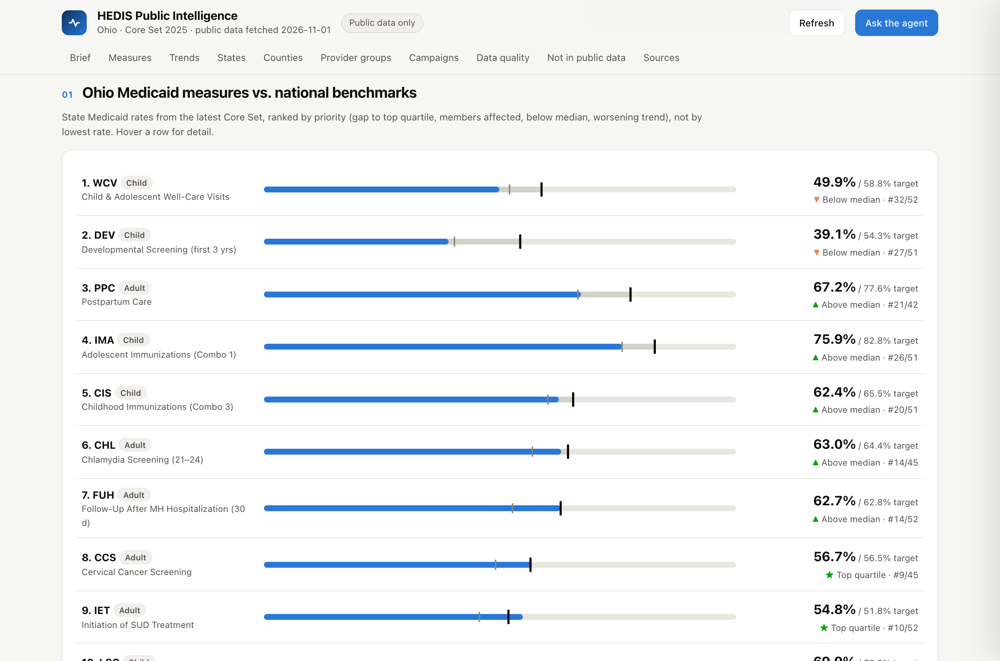
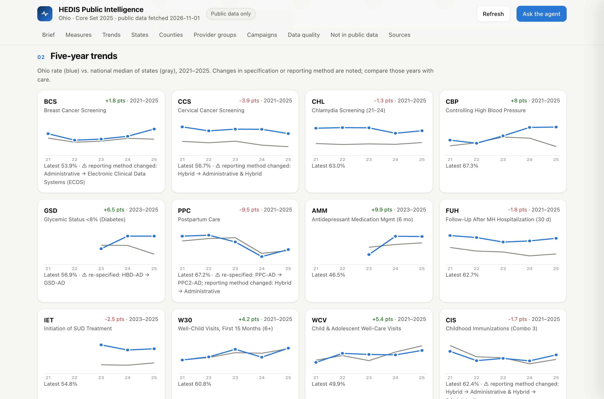
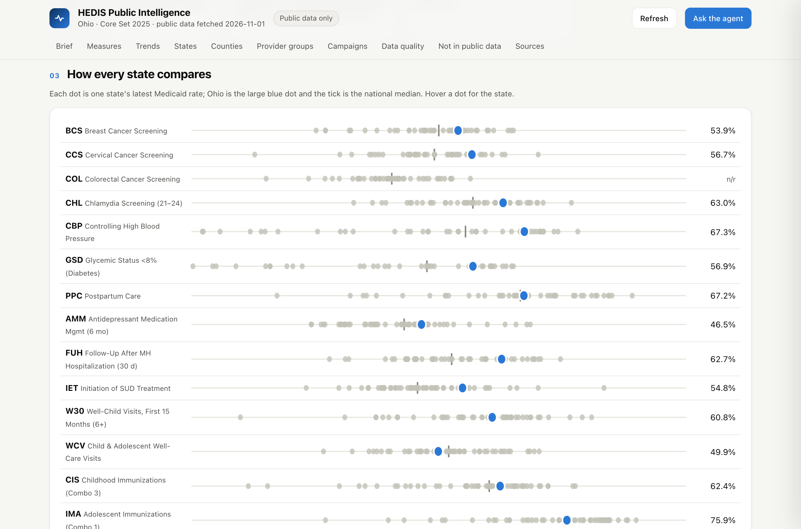
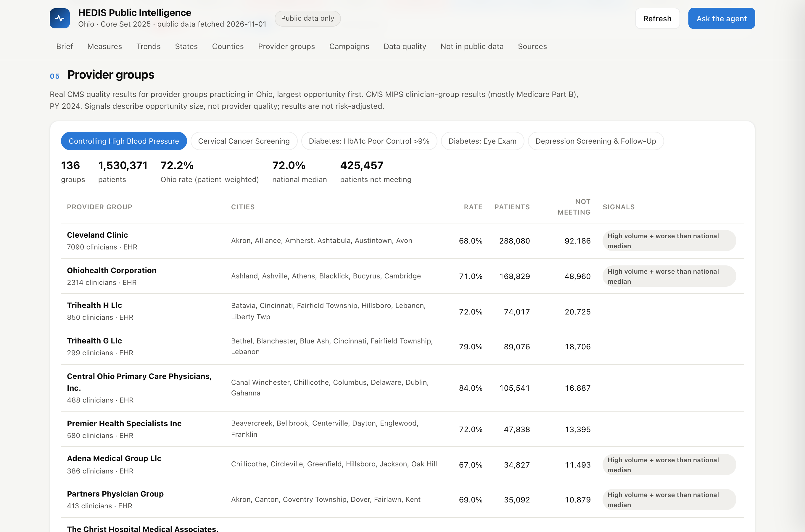
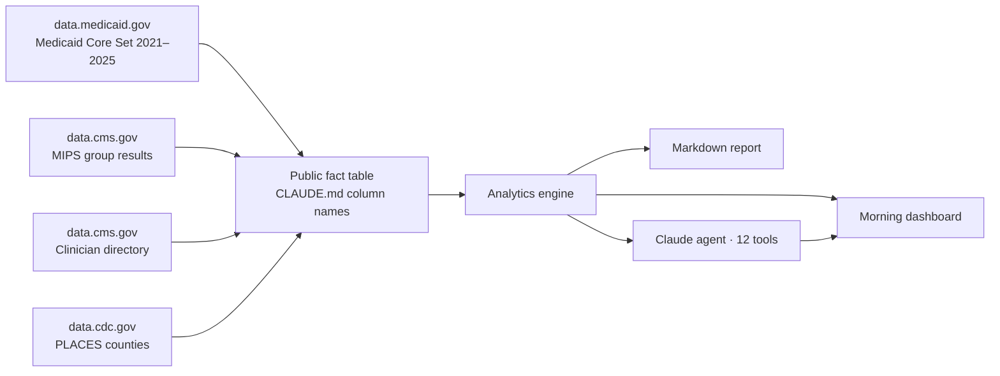

<div align="center">

# HEDIS Public Intelligence Agent

**An AI agent that turns public quality data into a HEDIS work plan for value-based care teams.**

*Where is our state behind? Is it really improving? Which communities and provider groups should we start with? What can't public data tell us?*

    



**[📘 Build guide](docs/BUILD_GUIDE.md)** · [Methodology](docs/methodology.md) · [Data sources & citations](docs/data-sources.md)

</div>

---

## What it is

A HEDIS analyst agent that runs **only on public data**: no patient records, payer files, EHR extracts or synthetic data. It pulls four U.S. federal APIs, builds one fact table, and answers value-based-care questions at the levels public data supports: **state Medicaid program, provider group and county.** When public data can't answer a question (individual patients, payer-vs-EHR reconciliation, commercial plan rates, contract targets), it says so and names the data needed.

| VBC question | What the agent does with public data |
|---|---|
| How are we performing? | 16 HEDIS-based Medicaid Core Set measures for the focus state, each with its denominator, national median, quartiles and rank among states |
| What's the target? | The **top-quartile state rate**, labeled with its source, converted to *members needed* where a member denominator exists |
| Is it really improving? | 2021–2025 trends against the national median, flagging measures that were **re-specified or changed reporting method** so they aren't misread |
| Which measures first? | Ranks on gap to target, members affected, position vs. median and trend direction, not lowest rate alone |
| Which providers? | Real CMS quality results for provider groups based in the state, with patients not meeting each measure |
| Which communities? | CDC county estimates for screening, chronic disease and access; campaigns target the counties with the largest need |
| Can we trust the data? | Data-quality checks on the sources: unreported measures, hybrid samples, re-specifications, small denominators, wide confidence intervals |

<table>
<tr><td width="50%"><br><b>Measures</b> vs. national median and top quartile</td>
<td width="50%"><br><b>Trends</b>, with re-specification flags</td></tr>
<tr><td width="50%"><br><b>Every state</b> compared</td>
<td width="50%"><br><b>Provider groups</b> from CMS</td></tr>
</table>

## Sample findings: Ohio (public data, fetched 2026-11-01)

- Ohio Medicaid reports **15 of 16** tracked measures in the 2025 Core Set. **Cervical cancer screening** and **SUD treatment initiation** are in the top quartile of states; **child & adolescent well-care visits** and **developmental screening** are below the median
- **Top priority, well-care visits (WCV):** 49.9% of 1,068,498 members vs. a 58.8% top quartile, so about **95,100 more children and adolescents** need a visit to reach it. The rate is up 5.4 points since 2021
- **Postpartum care looks like it fell 9.5 points**, but the measure was re-specified (PPC-AD → PPC2-AD) and switched from hybrid to administrative reporting in the same period, so the agent flags the trend instead of calling it a decline
- **Colorectal screening** isn't reported by Ohio at all. That's a data gap, not a 0%
- **Largest community need:** Cuyahoga County, about 131,600 adults with diagnosed diabetes (CDC PLACES)
- **Provider groups:** 136 Ohio-based groups report blood-pressure control to CMS, covering 1.5 million patients at a combined 72.2% (national group median 72.0%). Their eye-exam rate for patients with diabetes is 49.0%, and **about 311,600 patients didn't get one**. That's the clearest provider-partnership opportunity

---

## How it works



1. **Rules first.** [`CLAUDE.md`](CLAUDE.md) defines how a VBC HEDIS analyst reasons. It is the agent's system prompt, and its column names label the fact table.
2. **Public data in.** Four federal APIs, cached in [`data/public/`](data/public) so the project runs offline.
3. **One fact table.** About 3,900 rows: state × measure × year, provider group × measure, county × indicator. No patient fields.
4. **Deterministic analytics.** Plain Python computes every number; the dashboard, report and agent read the same results.
5. **Claude as the interface.** The agent calls tools for every figure and explains it as *Observation → Why it matters → Recommended action*.

Step-by-step rebuild with commands and checkpoints: **[Build guide](docs/BUILD_GUIDE.md)**.

---

## Data sources

| # | Source | Used for |
|---|---|---|
| 1 | CMS, *Medicaid & CHIP Child and Adult Core Set*, 2021–2025 releases (data.medicaid.gov) | State rates, national median and quartiles, targets, trends, state comparison |
| 2 | CMS, *PY 2024 Group Public Reporting: MIPS Measures and Attestations* (data.cms.gov, `0ba7-2cb0`) | Provider-group rates and patient counts |
| 3 | CMS, *Doctors and Clinicians National Downloadable File* (data.cms.gov, `mj5m-pzi6`) | Which groups practice in the state |
| 4 | CDC, *PLACES: County Data, 2025 release* (data.cdc.gov, `i46a-9kgh`) | County screening, prevalence and access estimates |
| 5 | CMS, *NPPES NPI Registry API* | Optional provider lookup |

Full citations, dataset IDs, fields and caveats: [docs/data-sources.md](docs/data-sources.md). Prioritization weights are model settings, labeled *illustrative — require business approval*.

---

## Quick start

```bash
git clone https://github.com/vivilicious-os/hedis-care-gap-agent.git
cd hedis-care-gap-agent
python -m hedis_agent serve        # http://localhost:8000, using cached public data
```

| Command | What it does |
|---|---|
| `refresh` | Re-pull all public APIs and rebuild the fact table (`HEDIS_STATE=TX` for another state) |
| `build` | Rebuild the fact table from cached data |
| `serve` | Dashboard + agent chat on localhost |
| `morning` | Daily run: refresh, rebuild, report, static dashboard, dated brief |
| `summary` · `measures` · `campaigns` · `quality` | Print results as JSON |
| `report` · `site` | Markdown report · static dashboard in `docs/` |
| `ask [question]` | Ask the agent (`pip install -r requirements.txt` and `ANTHROPIC_API_KEY`) |
| `npi <NPI>` | Look up a provider in NPPES |

## Project structure

```
hedis_agent/
  medicaid.py · cms.py · places.py · nppes.py   public API clients
  facts.py          public fact table (CLAUDE.md column names)
  analytics.py      measures, trends, states, providers, counties, campaigns, data quality
  agent.py          Claude tool-use agent (12 tools)
  server.py · web/dashboard.html   dashboard + chat
  report.py · morning.py · config.py
data/public/        cached public API pulls + fact table
docs/               build guide, methodology, data sources, static dashboard
output/             generated report
tests/              tests on the cached public data
CLAUDE.md           the agent's rules and system prompt
```

## Guardrails

- **Public data only.** No patient, payer-file, EHR or synthetic data
- **Denominators shown** wherever the source publishes one; hybrid samples are never presented as member counts
- **No invented targets or benchmarks.** Targets are public top-quartile state rates and say so
- **Trends checked for comparability** before being called improvement or decline
- **Provider signals describe opportunity, not quality**; not risk-adjusted; multi-state systems excluded
- **Unanswerable questions say so**, with the data that would be needed

## Limitations

- Core Set rates describe state Medicaid/CHIP programs, not individual plans; commercial and Medicare Advantage HEDIS results aren't publicly available through an API
- CMS MIPS measures are related to, but not the same as, HEDIS measures
- CDC PLACES values are model-based survey estimates for all adults
- Only the 2025 Core Set publishes denominators

---

HEDIS® is a registered trademark of the National Committee for Quality Assurance (NCQA). This project is independent and not affiliated with or endorsed by NCQA or CMS. **Proof of concept. Not for clinical decision-making.** [MIT License](LICENSE).
